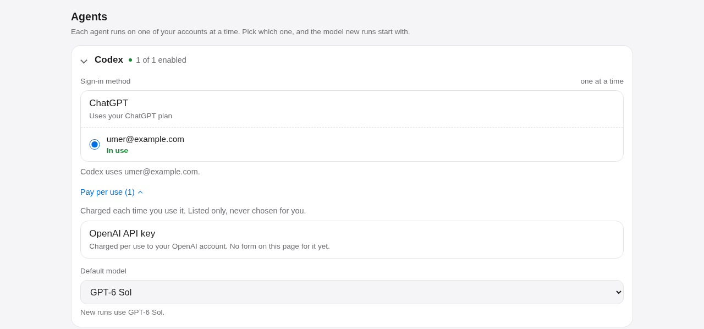
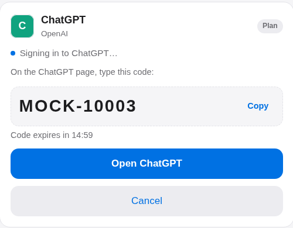
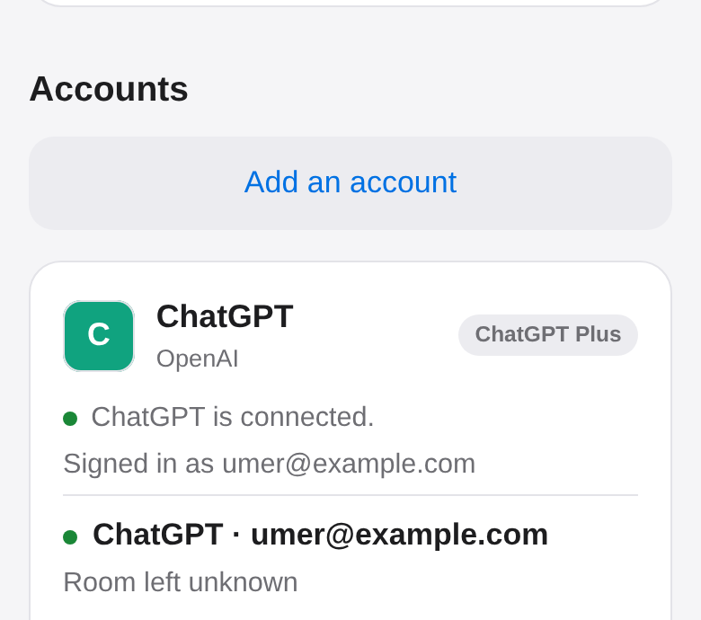
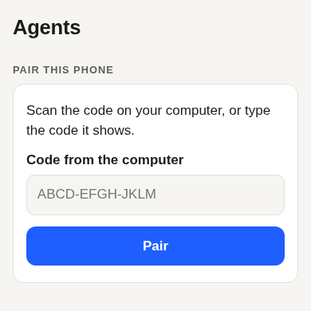
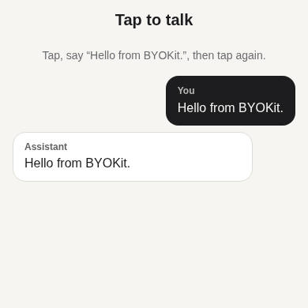

<div align="center">
<picture>
  <source media="(prefers-color-scheme: dark)" srcset="docs/readme/wordmark-dark.svg" />
  
</picture>

<strong>Ship apps where people sign in with the AI plan they already pay for.</strong>

<p>TypeScript kits that let people sign in to your app with ChatGPT, Claude or other plans they already pay for, on web, phone and desktop.</p>

<picture>
  <source media="(max-width: 600px) and (prefers-color-scheme: dark)" srcset="docs/readme/agents-phone-dark.png" />
  <source media="(max-width: 600px)" srcset="docs/readme/agents-phone-light.png" />
  <source media="(prefers-color-scheme: dark)" srcset="docs/readme/agents-dark.png" />
  
</picture>

[Quick start](#quick-start) · [Packages](packages) · [Examples](examples) · [Contributing](CONTRIBUTING.md)

[](https://www.npmjs.com/org/byokit) [](https://github.com/umeranjum17/byokit/actions/workflows/ci.yml) [](LICENSE)
</div>

## Quick start

Install the published `@byokit/accounts` **0.33.0** package in an empty folder:

```sh
mkdir byokit-demo && cd byokit-demo
npm i @byokit/accounts@0.33.0
node -e "import('@byokit/accounts').then(m => console.log(Object.keys(m.PROVIDERS).length, 'provider routes'))"
```

The last command prints how many provider routes the typed entry point exposes. Nothing signs in and no provider is called.

For the whole offline sign-in-and-answer journey, with no account, network or key, use the [accounts quick start](packages/accounts#quickstart).

## Why BYOKit

| Instead of… | BYOKit gives your app… |
| --- | --- |
| Rebuilding each provider's sign-in by hand | Typed sign-in and provider helpers behind package APIs |
| Treating a subscription like an API key | Plan and per-use billing labelled apart; API-key routes are opt-in |
| Sending credentials to a pooling proxy | Sign-ins stored by the app and sent straight to the provider; BYOKit hosts no pooling service |
| Writing a bespoke device link | Pairing, discovery and encrypted link kits you can compose |

## What you get

<table>
<tr><td width="50%"><picture><source media="(prefers-color-scheme: dark)" srcset="docs/readme/signin-dark.png" /></picture><br><strong>Sign in without typing a password.</strong><br>The person enters a device code on the provider's own page; the app never sees it.</td><td width="50%"><picture><source media="(prefers-color-scheme: dark)" srcset="docs/readme/plan-dark.png" /></picture><br><strong>Bill what the plan already covers.</strong><br>The plan behind the account is shown on the card, not guessed.</td></tr>
<tr><td><picture><source media="(prefers-color-scheme: dark)" srcset="docs/readme/pair-invitation-dark.png" /></picture><br><strong>Pair a phone with a computer.</strong><br>Compare two words before an encrypted link is approved.</td><td><picture><source media="(prefers-color-scheme: dark)" srcset="docs/readme/reply-dark.png" /></picture><br><strong>Put voice in the app's own screen.</strong><br>Realtime voice, audio and dictation kits, not a bolted-on window.</td></tr>
</table>

These are captures of the examples in this repository, run with local stand-ins and the demo person Umer. No personal account and no live provider is involved.

## Proof

- **Published releases.** [`@byokit/accounts`](https://www.npmjs.com/package/@byokit/accounts) is at **0.33.0** and [`@byokit/pair`](https://www.npmjs.com/package/@byokit/pair) at **0.10.4**; every version and its notes are in the [release history](https://github.com/umeranjum17/byokit/releases).
- **Tests and types.** The [CI workflow](.github/workflows/ci.yml) builds every package, type-checks sources and tests, and runs the suite. Rerun it yourself with `npm ci --no-audit --no-fund`, `npm run build`, `npm run check`, `npm test` (details in [contributing](CONTRIBUTING.md)).
- **Runnable examples.** [Web/PWA](examples/pwa), [Expo and React Native](examples/expo), [offline voice](examples/realtime-voice) and [computer pairing](examples/herdr-kit) are apps in this repository, not screenshots of one.
- **What is not claimed here.** There are no user counts, quotes or benchmark numbers on this page; the links above are the evidence, and each one can be opened or rerun.

## Packages

| Build | Packages |
| --- | --- |
| Sign in and understand plans | [accounts](packages/accounts), [usage](packages/usage) |
| Pair devices and communicate | [pair](packages/pair), [discover](packages/discover), [relay](packages/relay), [link](packages/link), [signaling](packages/signaling) |
| Voice and on-device AI | [realtime](packages/realtime), [audio](packages/audio), [dictation](packages/dictation), [infer](packages/infer), [speak](packages/speak) |
| Decide and connect tools | [decide](packages/decide), [connect](packages/connect), [mcp](packages/mcp) |
| Runtime and app capabilities | [openclaw](packages/openclaw), [herdr](packages/herdr), [cloud](packages/cloud), [browser](packages/browser), [phone](packages/phone), [record](packages/record), [bubble](packages/bubble), [overlay](packages/overlay), [statusbar](packages/statusbar) |
| UI and private data | [ui](packages/ui), [ui-core](packages/ui-core), [secrets](packages/secrets), [seal](packages/seal), [push](packages/push), [outbox](packages/outbox), [write](packages/write) |

Some kits are private, deprecated or still awaiting qualification; each package guide states its status and platform support. [Browse all package guides](packages).

<details>
<summary>More: docs, security and project details</summary>

- [Web example](examples/pwa) · [Mobile example](examples/expo) · [Voice example](examples/realtime-voice)
- [Runtime kits](docs/runtime-kits.md) · [Capability kits](docs/capability-kits.md) · [Cloud kit](docs/cloud-kit.md)
- [Vision](VISION.md) · [Package conventions](docs/kit-conventions.md) · [Contributing and platform checks](CONTRIBUTING.md)
- [Account security notes](packages/accounts/SECURITY.md) · [Relay security boundary](packages/relay/SECURITY.md)
- [Releases](https://github.com/umeranjum17/byokit/releases) · [Report a problem](https://github.com/umeranjum17/byokit/issues)
- [Previous README reference](docs/readme-reference.md) keeps the earlier install details and links.

</details>

## Contributing

```sh
npm ci --no-audit --no-fund
npm run build && npm run check && npm test
```

## License

[Apache-2.0](LICENSE) · [Notices](NOTICE)
