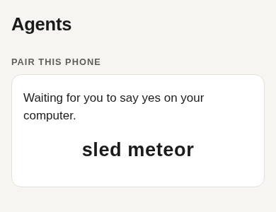
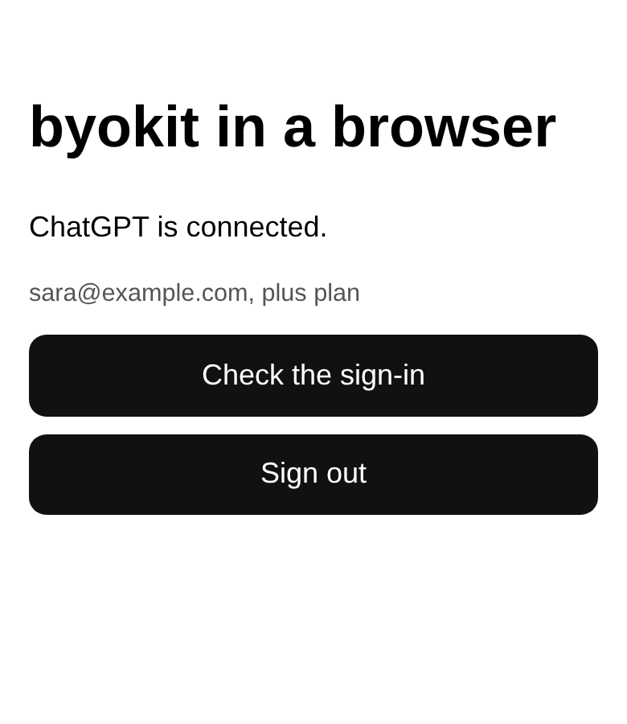
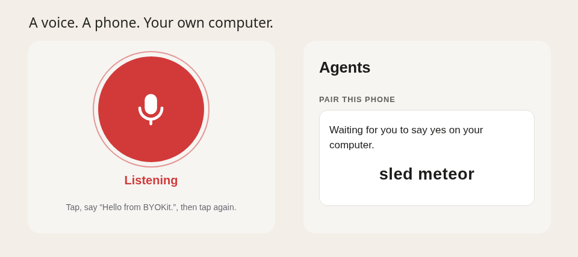

<div align="center">
<picture>
  <source media="(prefers-color-scheme: dark)" srcset="docs/readme/wordmark-dark.svg" />
  
</picture>

<strong>Ship apps using users’ existing AI plans, devices, and typed helpers—without pooling proxies.</strong>

<p>TypeScript kits for developers building web, mobile, desktop, and Node apps. Sign-ins stay in your app; subscription use is labeled separately from pay-per-use API keys.</p>

<picture>
  <source media="(max-width: 600px) and (prefers-color-scheme: dark)" srcset="docs/readme/pair-dark.png" />
  <source media="(max-width: 600px)" srcset="docs/readme/pair-light.png" />
  <source media="(prefers-color-scheme: dark)" srcset="docs/readme/pair-dark.png" />
  
</picture>

</div>

## Quick start

Install the published `@byokit/accounts` **0.33.0** package in a clean folder, then confirm the typed entry point loads:

```sh
mkdir byokit-demo && cd byokit-demo
npm init -y && npm i @byokit/accounts@0.33.0
node -e "import('@byokit/accounts')"
```

The last command exits successfully when the public entry point loads. This does not sign in or make a provider request.

[Quick start](#quick-start) · [Packages](packages) · [Examples](examples) · [Contributing](CONTRIBUTING.md)

[](https://www.npmjs.com/org/byokit) [](https://github.com/umeranjum17/byokit/actions/workflows/ci.yml) [](LICENSE)

For the complete offline sign-in-and-response journey, see the [accounts quick start](packages/accounts#quickstart) and its loopback stand-in.

## Why BYOKit

| Instead of… | BYOKit gives your app… |
| --- | --- |
| Rebuilding each provider flow yourself | Typed sign-in and provider helpers behind package APIs |
| Treating a subscription like an API key | Separate labels for subscription plans and per-use API billing; API-key routes require opt-in |
| Sending credentials to a pooling proxy | App-owned sign-in storage and direct provider flows; no BYOKit-hosted pooling service |
| Building a bespoke device link | Pairing, discovery and encrypted link kits you can compose |

## What you get

<table>
<tr><td width="50%"><br><strong>Pair devices with care.</strong><br>Compare words before approving an encrypted link.</td><td width="50%"><br><strong>Build voice flows.</strong><br>Realtime voice, audio and dictation kits for your app's interface.</td></tr>
<tr><td><br><strong>Sign in with a plan.</strong><br>Keep sign-ins in app-chosen storage and present the provider's subscription route.</td><td><br><strong>Compose typed capabilities.</strong><br>Usage, decisions, runtime and UI kits are separate packages.</td></tr>
</table>

These are real examples, not design mockups. Demo data uses Umer. The voice run uses a simulated microphone and an offline peer; pairing stops before approval. No personal account or live provider is used in the captures.

## Proof

- [Published npm releases](https://www.npmjs.com/org/byokit): for example, `@byokit/accounts` **0.33.0** and `@byokit/pair` **0.10.4**. See the [release history](https://github.com/umeranjum17/byokit/releases).
- The repository's [CI workflow](.github/workflows/ci.yml) runs the build, TypeScript checks and test suite. Reproduce locally with `npm run build`, `npm run check`, and `npm test` (see [contributing checks](CONTRIBUTING.md)).
- Real consumer examples: [PWA](examples/pwa), [Expo](examples/expo), [offline voice](examples/realtime-voice), and [Herdr phone pairing](examples/herdr-kit).

## Packages

| Build | Packages |
| --- | --- |
| Sign in and understand plans | [accounts](packages/accounts), [usage](packages/usage) |
| Pair devices and communicate | [pair](packages/pair), [discover](packages/discover), [relay](packages/relay), [link](packages/link), [signaling](packages/signaling) |
| Voice and on-device AI | [realtime](packages/realtime), [audio](packages/audio), [dictation](packages/dictation), [infer](packages/infer), [speak](packages/speak) |
| Decide and connect tools | [decide](packages/decide), [connect](packages/connect), [mcp](packages/mcp) |
| Runtime and app capabilities | [openclaw](packages/openclaw), [herdr](packages/herdr), [cloud](packages/cloud), [browser](packages/browser), [phone](packages/phone), [record](packages/record), [bubble](packages/bubble), [overlay](packages/overlay), [statusbar](packages/statusbar) |
| UI and private data | [ui](packages/ui), [ui-core](packages/ui-core), [secrets](packages/secrets), [seal](packages/seal), [push](packages/push), [outbox](packages/outbox), [write](packages/write) |

Some kits are private, deprecated or still awaiting qualification; each package guide states its status and platform support. [Browse all package guides](packages).

<details>
<summary>More: examples, security, and project details</summary>

- [Web example](examples/pwa) · [Mobile example](examples/expo) · [Voice example](examples/realtime-voice)
- [Runtime kits](docs/runtime-kits.md) · [Capability kits](docs/capability-kits.md) · [Cloud kit](docs/cloud-kit.md)
- [Vision](VISION.md) · [Package conventions](docs/kit-conventions.md) · [Contributing and platform checks](CONTRIBUTING.md)
- [Account security notes](packages/accounts/SECURITY.md) · [Relay security boundary](packages/relay/SECURITY.md)
- [Releases](https://github.com/umeranjum17/byokit/releases) · [Report a problem](https://github.com/umeranjum17/byokit/issues)
- [Previous README reference](docs/readme-reference.md) retains the prior installation details and links.

</details>

## Contributing

```sh
npm ci --no-audit --no-fund
npm run build && npm run check && npm test
```

## License

[Apache-2.0](LICENSE) · [Notices](NOTICE)
